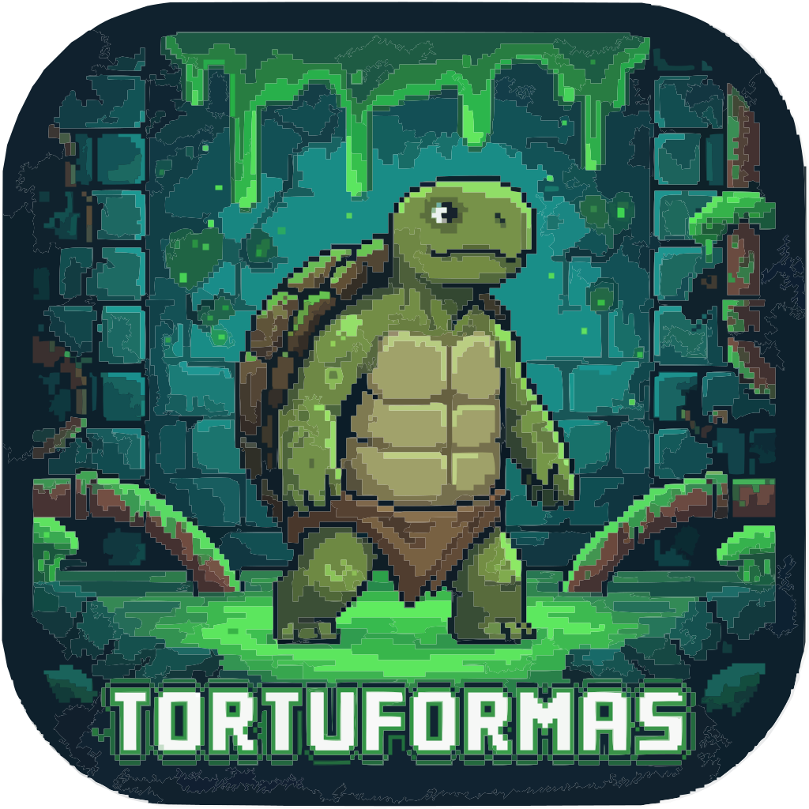
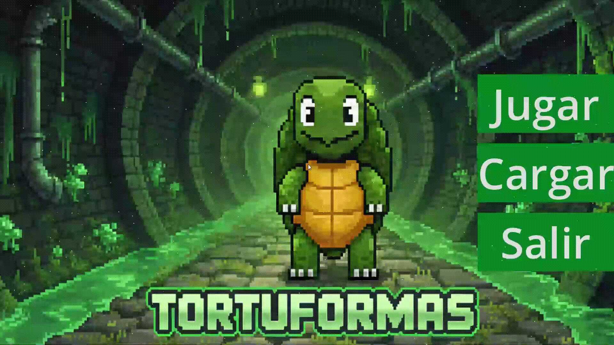

<p align="center">
  
</p>

<h1 align="center">Tortuformas</h1>

<p align="center">
  Juego de plataformas 2D en el que una tortuga recoge monedas, esquiva trampas y enemigos, y cambia de tamaño para superar siete niveles.
  En Windows funciona perfectamente, en Linux no esta probado pero tendria que funcionar y en Android esta en pronceso.
</p>

<p align="center">
  
  
  
  
</p>

<p align="center">
  
</p>

## Contenido

- [Características](#características)
- [Cómo se juega](#cómo-se-juega)
- [Descargar y jugar](#descargar-y-jugar)
- [Abrir el proyecto en Godot](#abrir-el-proyecto-en-godot)
- [Exportar el juego](#exportar-el-juego)
- [Partida guardada](#partida-guardada)
- [Solución de problemas](#solución-de-problemas)
- [Estructura del proyecto](#estructura-del-proyecto)

## Características

| Función | Detalle |
|---|---|
| Siete niveles | Cada nivel se supera recogiendo todas sus monedas. Al final aparece la pantalla de victoria. |
| Crecer y menguar | A partir del nivel 4 la tortuga puede cambiar de tamaño para llegar a sitios distintos. |
| Peligros | Trampas que caen al detectarte, pinchos, balas disparadas cada pocos segundos y enemigos que patrullan o te persiguen. |
| Controles invertidos | Algunos objetos invierten la dirección en la que te mueves. |
| Contador de muertes | Cada vez que mueres el nivel se reinicia y suma una muerte. |
| Guardado | La partida se guarda al empezar cada nivel y se continúa desde el menú con "Cargar". |
| Pausa | Pausa en cualquier momento, con botón para salir. |
| Controles táctiles | Incluye botones en pantalla para moverse, saltar, crecer y menguar. |

## Cómo se juega

El objetivo de cada nivel es recoger todas las monedas. Al coger la última, pasas al siguiente nivel. Si tocas una trampa, un enemigo o una bala, mueres y el nivel empieza de nuevo.

| Acción | Teclas |
|---|---|
| Moverse | <kbd>A</kbd> / <kbd>D</kbd> o <kbd>←</kbd> / <kbd>→</kbd> |
| Saltar | <kbd>Espacio</kbd>, <kbd>W</kbd> o <kbd>↑</kbd> |
| Crecer (desde el nivel 4) | <kbd>E</kbd> |
| Menguar (desde el nivel 4) | <kbd>Q</kbd> |
| Pausa | <kbd>Esc</kbd> o <kbd>P</kbd> |
| Modo velocidad (depuración) | <kbd>Ctrl</kbd> + <kbd>Shift</kbd> mantenidos |

Para crecer o menguar hay que estar tocando el suelo. El tamaño va de un cuarto del normal hasta el doble.

PD: Hay 2 hotkeys para activar el GODMODE, no te afecta la hitbox enemiga, y el FASTMODE, vas mas rapido de lo normal hecha para el tedioso ultimo nivel.

## Descargar y jugar

1. Ve a la sección [builds](https://github.com/rubenalvanev/Tortuformas/tree/main/builds) en Windows o [builds linux](https://github.com/rubenalvanev/Tortuformas/tree/main/builds%20linux) en Linux y descarga el archivo de tu sistema.
2. Descomprímelo en una carpeta.
3. Ejecuta el juego:
   - **Windows:** `Tortuformas.exe`.
   - **Linux:** `Tortuformas.x86_64`.

No borres el archivo `Tortuformas.pck` ni el resto de archivos que vienen junto al ejecutable. Son necesarios para que el juego funcione. En Windows, `Tortuformas.console.exe` abre el juego con una consola de depuración y no hace falta para jugar.

El juego se abre a pantalla completa. Pulsa <kbd>Esc</kbd> o <kbd>P</kbd> para abrir la pausa y usa el botón **Salir** para cerrarlo.

> [!NOTE]
> Como el ejecutable de Windows no está firmado, SmartScreen puede mostrar el aviso "Windows protegió su PC". Pulsa "Más información" y después "Ejecutar de todas formas".

## Abrir el proyecto en Godot

Necesitas [Godot 4.5](https://godotengine.org/download) o una versión compatible.

```
git clone https://github.com/rubenalvanev/Tortuformas.git
```

1. Abre Godot y pulsa **Importar**.
2. Selecciona el archivo `project.godot` de la carpeta del proyecto.
3. Pulsa **Importar y editar** y después <kbd>F5</kbd> para jugar.

La primera vez, Godot tarda un poco en importar los recursos y crear la carpeta `.godot`, que no se sube al repositorio.

## Exportar el juego

El proyecto trae dos configuraciones de exportación listas: **Windows Desktop** y **Linux**.

1. En Godot, ve a **Editor, Administrar plantillas de exportación** y descarga las plantillas de tu versión.
2. Ve a **Proyecto, Exportar**.
3. Elige la configuración y pulsa **Exportar proyecto**.

Los archivos se generan en `builds/` para Windows y en `builds linux/` para Linux.

## Partida guardada

El progreso, con el nivel actual y el número de muertes, se guarda en el archivo `partida.tres` de la carpeta de datos de usuario del juego:

| Sistema | Carpeta |
|---|---|
| Windows | `%APPDATA%\Godot\app_userdata\Tortuformas` |
| Linux | `~/.local/share/godot/app_userdata/Tortuformas` |

Para empezar de cero, borra ese archivo.

## Solución de problemas

<details>
<summary>En Linux no se abre el juego</summary>

El archivo puede haber perdido el permiso de ejecución al descomprimirlo. Dáselo desde la carpeta del juego:

```
chmod +x Tortuformas.x86_64
```

</details>

<details>
<summary>El juego no encuentra sus datos</summary>

El archivo `Tortuformas.pck` debe estar en la misma carpeta que el ejecutable.

</details>

<details>
<summary>No puedo salir del juego</summary>

Se abre a pantalla completa. Pulsa <kbd>Esc</kbd> o <kbd>P</kbd> y después el botón **Salir**.

</details>

<details>
<summary>Godot dice que el proyecto es de otra versión</summary>

El proyecto está hecho con Godot 4.5. Usa esa versión o una posterior de la rama 4 para evitar avisos de compatibilidad.

</details>

## Estructura del proyecto

| Ruta | Contenido |
|---|---|
| `escenas/` | Escenas y scripts, una carpeta por elemento: niveles, personaje, enemigos, trampas, monedas, menú y pausa. |
| `scripts/` | Estado global del juego (nivel y muertes) y datos de la partida guardada. |
| `arts/` | Sprites, música y sonidos. |
| `shaders/` | Materiales, como el efecto rojo al morir. |
| `temas/` y `estilo_botones/` | Aspecto de la interfaz y de los botones. |
| `resources/` | Recursos de la partida. |
| `builds/` y `builds linux/` | Ejecutables exportados. |
| `export_presets.cfg` | Configuración de exportación para Windows y Linux. |

Tecnologías: Godot 4.5, GDScript y el renderizador Forward Plus.
